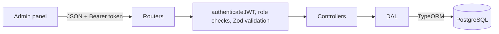

# Adinkra API

Backend for a cargo and logistics business: branches and warehouses book customer orders, split them into barcoded parcels, and move those orders and parcels between locations by van or in sea containers. Staff use it through the Adinkra admin panel (a separate frontend project); this repository is the API only.

It is an Express + TypeORM service on PostgreSQL, written in TypeScript, with Zod validating every request body and JWTs for authentication.

## What it does

- **Orders.** Booking an order records the sender and receiver (creating customer accounts for unknown phone numbers), the line items, a snapshot of the parcel size and the lane price, and checks the order in at the booking branch.
- **Movements.** `POST /orders/out` sends orders out of a branch on a vehicle; `POST /orders/in` checks them in somewhere else. Every movement is appended to the order's history, and an order can only move to the opposite of its last state: nothing is checked in twice or sent out twice. The `/:number/in/is-valid` and `/:number/out/is-valid` endpoints let a barcode scanner ask before it commits.
- **Parcels.** An order item can be split across several barcodes (`10` units over `3` barcodes gives parcels of `3`, `3` and `4`). Parcels move like orders, either on a vehicle or inside a container, and a container's tracking number lists what was loaded into it.
- **Location-scoped lists.** The order and parcel lists show where each item currently is. Staff see the locations they are assigned to, admins see everything, and `?locationId=` narrows it to one branch.
- **Reference data.** Countries, states, cities and areas; location types; vehicles and vehicle types; parcel sizes (packages) and lane prices.
- **Accounts.** Login by email or phone, 15-minute access tokens with a rotating refresh cookie, roles (`admin`, `manager`, `driver`, `employee`, `customer`) and per-user permission flags that the admin panel uses to show or hide actions.

## Running it

Docker Compose starts Postgres and the API. The `seed` service creates roles, permissions, location and vehicle types, an admin account and a small demo dataset:

```bash
docker compose up -d --build
docker compose --profile tools run --rm seed
```

The API is then on `http://localhost:3006/api`, with a liveness check at `http://localhost:3006/health`, and Postgres is published on port 5433. You can log in as `admin@example.com` / `Helloworld`; change that before the API is reachable by anyone else.

The demo seed (`npm run seed:demo`) adds Accra, Tema and Kumasi with a branch or warehouse in each, a van with a driver (`driver@example.com` / `Helloworld`), one parcel size and an Accra to Kumasi price. That is enough to book and move an order. The full `seed:countries`, `seed:states` and `seed:cities` seeders load every country, state and city from `country-state-city`; the cities step inserts tens of thousands of rows and takes a while.

### Without Docker

You need Node 22 (see `.nvmrc`) and a Postgres database.

```bash
cp .env.example .env        # then fill in the database and the two JWT secrets
npm install
npm run seed:permissions && npm run seed:user-roles && npm run seed:location-types \
  && npm run seed:vehicle-types && npm run seed:admin && npm run seed:demo
npm run dev
```

With `ENVIRONMENT=local` the API creates the database if it is missing and synchronises the schema from the entities on start. In any other environment it connects with `DATABASE_URL` and does not touch the schema. For a production build: `npm run build`, then `npm start`.

| Variable | Purpose |
| --- | --- |
| `ENVIRONMENT` | `local` or `test` connects with the host/user/password variables and syncs the schema; anything else uses `DATABASE_URL` over TLS |
| `PORT` | HTTP port (3006 in Compose) |
| `DATABASE_HOST`, `DATABASE_USER`, `DATABASE_PASSWORD`, `DATABASE_NAME` | Local connection |
| `DATABASE_URL` | Connection string for non-local environments |
| `DATABASE_LOGGING` | `true` prints every SQL statement with its parameters; off by default because those include password hashes and refresh tokens |
| `FRONT_END_DOMAIN` | Comma-separated origins allowed by CORS (credentials are allowed, so this is not `*`) |
| `JWT_SECRET_KEY`, `REFRESH_TOKEN_SECRET_KEY` | Signing secrets for access and refresh tokens |

## Using it

Every route except `/auth/*` and `/health` needs `Authorization: Bearer <token>`. The examples below were captured from the Compose stack with the demo seed; tokens and long ids are shortened.

Log in:

```http
POST /api/auth/login
{ "email": "admin@example.com", "password": "Helloworld" }

200 OK
Set-Cookie: REFRESH-TOKEN=...; HttpOnly; Secure; SameSite=None
{
  "token": "eyJhbGciOi...K8kE",
  "permissions": [{ "name": "User", "properties": { "add": true, "view": true, "update": true, "remove": true } }, ...],
  "locations": [{ "name": "Accra Central Branch", "city": { "name": "Accra", ... } }, ...]
}
```

Book an order at the Accra branch:

```http
POST /api/orders
{
  "sender_name": "Ama Owusu", "sender_phone": "+233 24 000 0101", "sender_address": "12 Ring Road", "sender_city_id": "<Accra>",
  "receiver_name": "Yaw Boateng", "receiver_phone": "+233 27 000 0202", "receiver_address": "4 Prempeh Street", "receiver_city_id": "<Kumasi>",
  "total_quantity": 4, "sub_total": 40, "discount": 0, "total_amount": 85,
  "payment_type": "cash", "payment_status": "paid", "payment_date": "2026-11-09T09:00:00.000Z",
  "weight_type": "kg", "total_weight": 6,
  "location_id": "<Accra Central Branch>", "package_id": "<Small box>",
  "pricing": { "from_city_id": "<Accra>", "to_city_id": "<Kumasi>", "package_id": "<Small box>", "price": 45 },
  "orderItems": [{ "name": "Kente cloth", "quantity": 4, "price": 10, "weight": 1.5 }]
}

201 Created
{
  "id": "01M6YEAH351AMXJDX8ZCS1ZT4X",
  "order_number": "1794170504290448513",
  "status": "pending",
  "package": { "name": "Small box (up to 5 kg)", "route": "road", "weight_type": "kg", "weight_limit": "5.00", ... },
  "pricing": { "price": "45.00", "route": "road", "from_city": { "name": "Accra", ... }, "to_city": { "name": "Kumasi", ... } },
  "order_items": [{ "name": "Kente cloth", "quantity": 4, "price": "10.00", "total_price": "40.00", ... }],
  "history": [{ "name": "Accra Central Branch", "city": "Accra", "status": "in", ... }],
  ...
}
```

Send it to Kumasi, then try to send it again:

```http
POST /api/orders/out
{ "order_numbers": ["1794170504290448513"], "from_location_id": "<Accra>", "to_location_id": "<Kumasi>", "vehicle_id": "<van>" }

200 OK   { "success": ["1794170504290448513"], "failed": [] }
200 OK   { "success": [], "failed": ["1794170504290448513"] }      <- second call: it is already out
```

List what is at a branch (each order carries only its latest history entry):

```http
GET /api/orders?locationId=<Accra Central Branch>&pageSize=2

200 OK
{
  "pageInfo": { "pageNumber": 1, "pageSize": 2, "totalPages": 4, "totalResults": 7 },
  "results": [
    {
      "order_number": "1794170504290448513", "sender_name": "Ama Owusu", "receiver_name": "Yaw Boateng",
      "history": [{ "name": "Accra Central Branch", "city": "Accra", "status": "out", ... }],
      "sender_city": { "name": "Accra", "state": { "name": "Greater Accra", "country": { "name": "Ghana", "code": "GH" } } },
      ...
    },
    ...
  ]
}
```

Lists take `pageNumber`, `pageSize` (at most 100), `q` for full-text search, `sortBy` (any column) and `orderBy` (`ASC`/`DESC`).

Split the four units into three barcoded parcels, or ask for too many:

```http
POST /api/parcels
{ "location_id": "<Accra Central Branch>", "parcel_data": [{ "item_id": "<Kente cloth>", "number_of_barcodes": 3 }] }

201 Created   [ { "parcel_number": "1794170504362181513", "parcel_items": [{ "quantity": 1 }] },
                { "parcel_number": "1794170504365242172", "parcel_items": [{ "quantity": 1 }] },
                { "parcel_number": "1794170504368556380", "parcel_items": [{ "quantity": 2 }] } ]

{ ..., "number_of_barcodes": 9 }
422   { "message": "Cannot split 4 item(s) into 9 parcels." }
```

Errors are always JSON. Invalid bodies return the Zod issues, and a self-registered customer cannot reach the back office:

```http
POST /api/orders   { "sender_name": "x" }
422   { "errors": [{ "path": ["sender_phone"], "message": "Required", ... }, ...] }

GET /api/orders    (customer token)
403   { "message": "Your role is not authorized to perform this action!" }
```

### Routes

| Prefix | Who | Notes |
| --- | --- | --- |
| `/auth` | anyone | `POST /login`, `POST /signup` (creates a customer), `GET /refresh` (reads the refresh cookie and rotates it) |
| `/users` | admin, manager; anyone for their own record | Users cannot change their own role, permissions, status or locations; deleting needs an admin |
| `/user-roles`, `/permissions` | admin | |
| `/orders` | staff | CRUD, `POST /in`, `POST /out`, `GET /:number/{in,out}/is-valid` |
| `/parcels` | staff | create, list, read, delete, `POST /in`, `POST /out`, `GET /:number/{in,out}/is-valid` |
| `/containers` | staff | CRUD and `GET /track/:tracking_number` |
| `/vehicles`, `/vehicle-types`, `/locations`, `/location-types`, `/packages`, `/pricings` | staff | |
| `/countries`, `/states`, `/cities`, `/areas` | staff | `GET /countries/:id/states`, `GET /states/:id/cities` |

"Staff" means any role except `customer`, including custom roles an admin creates.

## How it is put together



```
src/
  routes/        one router per resource; index.ts applies auth and role gates
  middlewares/   authenticateJWT, role checks, Zod body validation
  controllers/   request/response handling
  dal/           data access and the business rules (booking, movements, parcel splitting)
  entities/      TypeORM models
  schemas/       Zod request schemas
  utils/         pagination, location scoping, movement rules, error mapping
  seeding/       seed scripts, including the demo dataset
tests/
  unit/          no database needed
  api/           contract tests against a running, seeded stack
```

A few choices worth knowing about:

- **History rows are snapshots.** Each movement stores the location, vehicle or container as JSON at the time it happened, and orders keep a copy of the package and price they were booked with. Renaming a branch or changing a price list later does not rewrite past shipments.

  ```mermaid
  stateDiagram-v2
    [*] --> in: booked / parcel created at a branch
    in --> out: POST /out (vehicle or container)
    out --> in: POST /in at the destination
  ```

- **Validation strips unknown keys.** The middleware replaces `req.body` with Zod's parsed output, so the DAL can spread request bodies into entities without exposing columns the schema does not mention.
- **Database errors are translated.** A unique-constraint violation becomes a `409`, other driver errors a generic `422`, and constraint names never reach the client.
- **Numbers on barcodes** (orders, parcels, tracking) are a millisecond timestamp plus six random digits, always 19 digits long.

## Tests

```bash
npm test          # unit tests, no database or network
npm run lint
npx tsc --noEmit -p .
```

The contract tests in `tests/api` call a running API. Start the Compose stack and seed it as above, then:

```bash
npm run test:api                        # API_BASE defaults to http://localhost:3006/api
```

They cover authentication and role boundaries, booking and editing orders, in/out movements, parcel splitting, container tracking, and vehicle and container deletion. Each run creates its own users and orders, so they can be repeated against the same database.

## Known limitations

- There are no migrations. Local runs synchronise the schema from the entities; any other environment needs the schema created separately.
- The per-user permission flags (`add`, `view`, `update`, `remove` per resource) are enforced by the admin panel only. The API enforces roles: admin-only routes, staff versus customer, and self-service limits on `/users`.
- New staff accounts created through `POST /users` get the password `Helloworld` unless one is supplied, and there is no password-reset flow.

## License

MIT, see [LICENSE](LICENSE).
